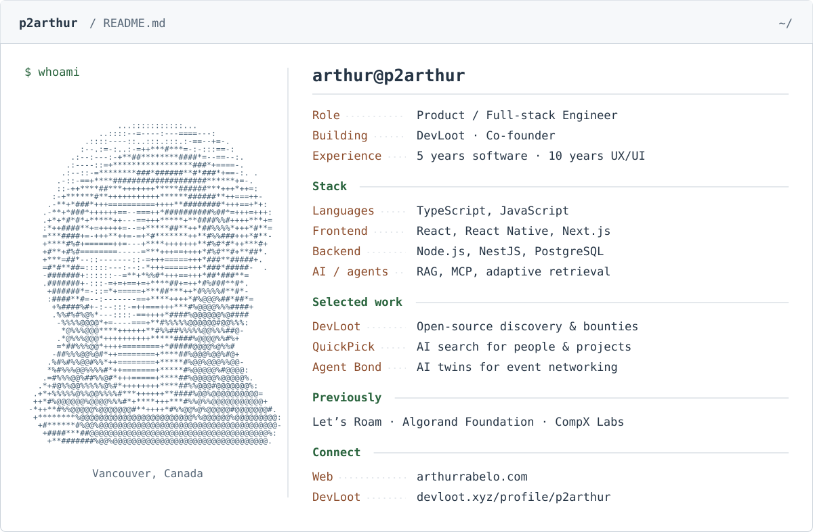

<h1>Arthur Rabelo <sub>· @p2arthur</sub></h1>

<picture>
  <source media="(max-width: 640px) and (prefers-color-scheme: dark)" srcset="./assets/profile-dark-mobile.svg" />
  <source media="(max-width: 640px)" srcset="./assets/profile-light-mobile.svg" />
  <source media="(prefers-color-scheme: dark)" srcset="./assets/profile-dark.svg" />
  
</picture>

I build products from the first design to production, with a focus on interfaces, developer tools, and AI systems. I'm the co-founder and primary builder of [DevLoot](https://devloot.xyz), connecting open-source maintainers and contributors through discovery and funded GitHub issues. I designed and built its adaptive search, RAG pipeline, and Project Planner.

[Portfolio](https://arthurrabelo.com) · [DevLoot profile](https://devloot.xyz/profile/p2arthur) · [LinkedIn](https://www.linkedin.com/in/arthur-rabelo-pro/) · [Email](mailto:arthurrabelopro@gmail.com)

### A few things I've worked on

| Project | My work |
| :--- | :--- |
| [DevLoot / QuickPick](https://devloot.xyz) | Open-source discovery, adaptive retrieval, and grounded project planning. |
| [Agent Bond](https://github.com/p2arthur/team-agent-bond) | Built with a team at Web Summit Vancouver: networking twins, attendee matching, and conversation starters. |
| [wecoop](https://github.com/p2arthur/wecoop_client) | Primary builder of a social app for the Algorand community, later developed with collaborators. |

<details>
<summary>Profile in plain text</summary>

```text
arthur@p2arthur
-------------
Role         Product / Full-stack Engineer
Location     Vancouver, Canada
Building     DevLoot · Co-founder & primary builder
Experience   5 years in software · 10 years in UX/UI

Languages    TypeScript, JavaScript
Frontend     React, React Native, Next.js
Backend      Node.js, NestJS, PostgreSQL
AI / agents  RAG, MCP, adaptive retrieval

Previously   Let's Roam · Algorand Foundation · CompX Labs
```

</details>
